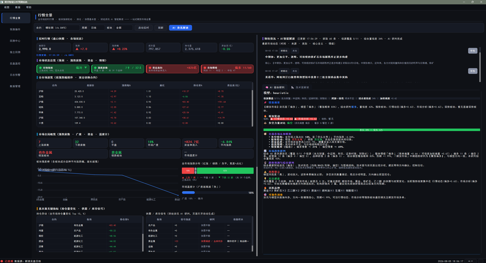
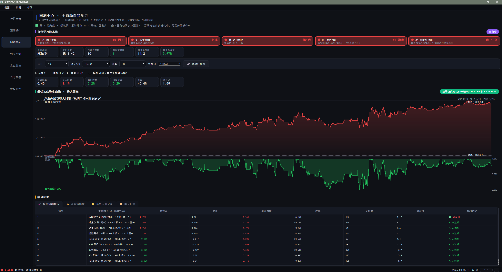
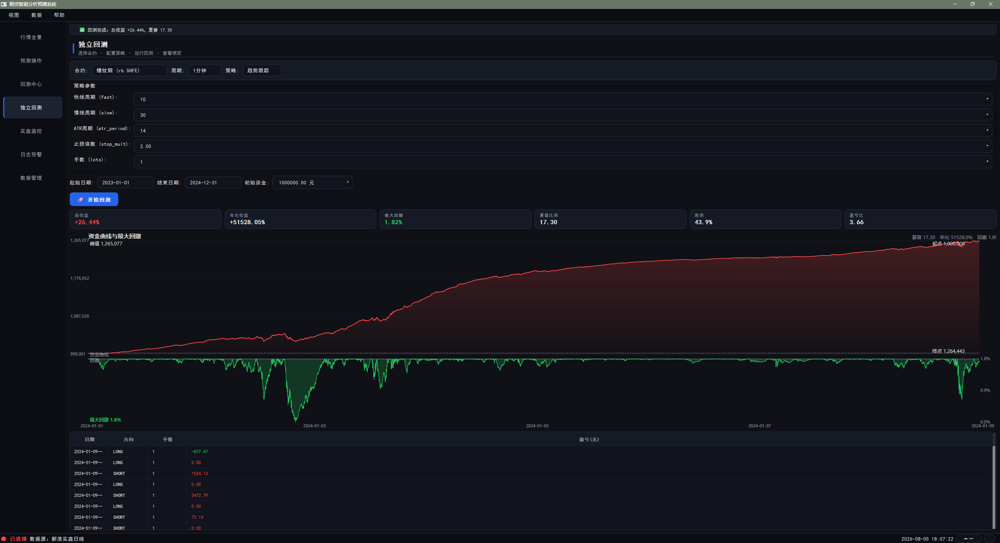
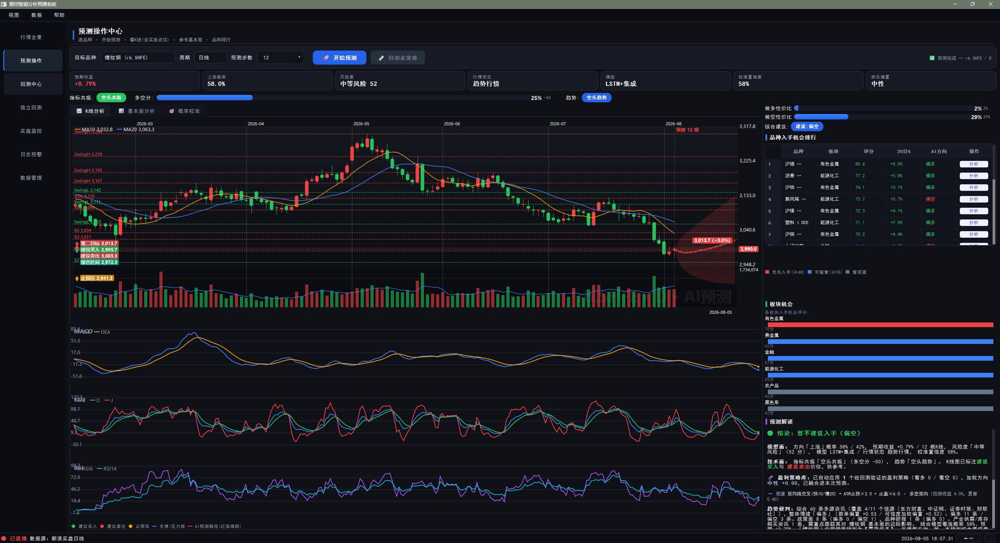
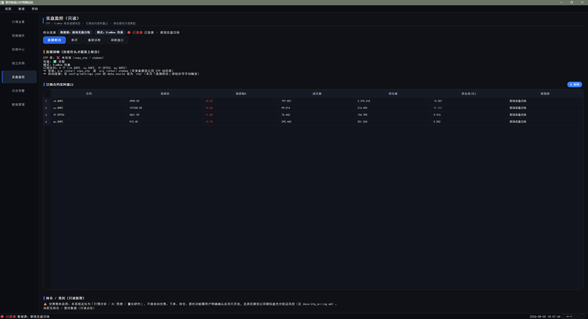

# QuantVortex · 期货量化分析回测系统

| |
| :---: |
|  |


**一个完全本地、零订阅、隐私自控的期货量化桌面工作台：看盘 → 预测 → 回测 → 验证 一站式闭环。**

---

## 30 秒看懂

> **QuantVortex** 是一个基于 PyQt6 的桌面端期货量化工具。它把行情浏览、技术指标分析、AI 趋势预测、图形化回测、策略自进化与风控管理集成到一个离线可用的程序里。
>
> - **给谁用**：想用数据验证交易想法、但不想搭 Python 环境、不想把交易数据交给云端的个人交易者 / 量化爱好者。
> - **解决什么**：把"盯盘、算指标、验策略、管风险"从多个割裂软件收敛到一个工作流，且**所有核心功能断网也能跑**。
> - **独特在哪**：默认**零重依赖纯 NumPy 实现**（无 TA-Lib / 无 torch 也能跑），可一键离线安装为绿色 EXE；回测引擎内置差异化手续费、保证金、滑点与涨跌停扩板；策略可用遗传算法自动进化。

---

## 核心痛点 · 我们解决什么

| 痛点 | 现状 | QuantVortex 的做法（如实） |
| --- | --- | --- |
| **信息割裂** | 行情、指标、新闻、回测分散在多个软件，时间戳与口径不一致 | 同一份数据在行情、预测、回测中口径一致；看盘→分析→验证闭环 |
| **验证门槛高** | 非程序员验证一个日内策略要配环境、清洗数据、写撮合逻辑，且易踩"未来函数" | 图形化配置策略参数、点击即跑事件驱动回测，引擎内置防未来函数约束 |
| **预测不可信** | 市面工具常给"90% 大涨"却连错，根因是训练集随机切分导致未来泄漏 | AI 预测采用**滚动窗口归一化 + 真·Walk-Forward 样本外验证 + Mincer-Zarnowitz 校准**，每条预测带点预测、置信区间与涨跌概率 |
| **数据主权** | 云端量化软件需注册、付费、上传策略与行情数据 | 绿色便携、SQLite 本地存储、核心密钥仅内存持有；无强制联网、无订阅费 |
| **回测失真** | 很多回测忽略开平今/平昨手续费差异、涨跌停、移仓换月成本 | 撮合引擎模拟差异化手续费、动态保证金、滑点、涨跌停扩板、移仓换月、逐日盯市 |

> ⚠️ **诚实声明**：本项目是**学习 / 研究 / 技术验证**工具，不是实盘信号源。所有 AI 预测与策略回测均为概率性研判，不构成投资建议。期货杠杆高、风险大。

---

## 功能全景

程序主界面采用左侧分组导航，共 **7 个主页面**：

| 页面 | 核心功能（已核实实现） |
| --- | --- |
| 📊 **行情全景** | 全市场行情速览表、涨跌家数 / 市场广度、资金净流入、板块强度榜、持仓异动、领涨领跌 / 资金流向榜单；可选接入财联社快讯做辅助情绪研判；内置 AI 综合研判标签页 |
| 🔮 **预测操作** | 品种 / 周期选择、AI 模型选择、多空方向切换；自绘 K 线 + 多副图指标、十字光标读数、AI 预测曲线叠加买卖信号；板块轮动与特征权重可视化 |
| 🧪 **回测中心** | 多策略回测、遗传算法策略自进化、绩效全维度报告（收益 / 风险 / 交易 / 资金）、资金曲线与回撤曲线、策略排行、HTML 报告导出 |
| 📈 **独立回测** | 单策略深度回测：参数可视化调整、资金曲线、交易明细导出、与基准曲线对比 |
| 🛰️ **实盘监控** | CTP 连接诊断与行情快照（**只读展示**；CTP 网关为适配层，需真实期货账号与前置地址，本仓库未做实盘验证） |
| 🔔 **日志预警** | 交易日志、预警记录、事件追溯；可配置涨跌幅 / 价格突破 / RSI 极端 / MACD 交叉 / 资金流异动规则 |
| 🗄️ **数据管理** | 行情下载（可选 AKShare / Sina）、本地备份恢复、远程 MySQL 备份迁移、CSV / JSON / ZIP 数据导出 |

**横向能力模块**

- **技术指标**：35+ 指标函数（RSI、MACD、KDJ、BOLL、CCI、ATR、ADX、SAR、DMI、OBV、VWAP、WillR、ROC、Stoch、Bias、HV 等），纯 NumPy 实现，**零 TA-Lib 依赖**。
- **AI 预测**：默认纯 NumPy LSTM（异常时回退岭回归）；安装 `torch` 可解锁双向 LSTM+Attention，安装 `LightGBM`/`XGBoost` 可解锁梯度提升树，安装 `arch` 可解锁 GARCH 波动率——**缺任何库均自动降级到 NumPy 实现，功能不丢**。
- **策略体系**：内置双均线、通道突破（Donchian / Dual Thrust）、Ichimoku、Keltner、ATR 跟踪、网格、均值回归、跨期 / 跨品种套利等模板；遗传算法自进化引擎（精英保留 + 锦标赛选择 + 子树交叉 + 变异）。
- **风控与仓位**：单笔最大亏损、单日最大亏损、总回撤止损、保证金风险度强平、涨跌停熔断；ATR 自适应仓位、简化凯利公式、金字塔加减仓。
- **持仓模拟**：`PaperPortfolio` 模拟账户——资金、保证金占用、风险度仪表盘。
- **品种覆盖**：内置 **40+ 期货品种**，覆盖黑色系、有色金属、贵金属、能源化工、农产品、金融六大板块。

---

## 界面预览

> 以下截图取自实际运行界面（纯 PyQt6 + QPainter 自绘，深色金融主题）。

| 行情全景 | 回测中心（自进化） |
| :---: | :---: |
|  |  |
| *全市场行情速览 + 资金流 + AI 综合研判* | *遗传算法进化策略、资金/回撤曲线与策略排行* |

| 独立回测 | 预测操作中心 |
| :---: | :---: |
|  |  |
| *参数配置 + 资金曲线 + 交易明细* | *K 线 + 多副图指标 + AI 预测 + 板块轮动* |

| 实盘监控（只读） |
| :---: |
|  |
| *CTP 连接诊断 + 行情快照* |

---

## 系统架构

采用五层解耦、数据互通的设计：

```
┌─────────────────────────────────────────────┐
│  界面表现层  futures_quant/ui   (PyQt6/QPainter)│
├─────────────────────────────────────────────┤
│  AI 模型层  futures_quant/ai  (NumPy 默认, torch 可选)│
├─────────────────────────────────────────────┤
│  回测/风控层 futures_quant/{backtest,risk,broker} │
├─────────────────────────────────────────────┤
│  计算核心层 futures_quant/{core,indicators,strategy}│
├─────────────────────────────────────────────┤
│  数据层    futures_quant/{data,storage}  (本地 SQLite) │
└─────────────────────────────────────────────┘
```

| 层 | 目录 | 职责 |
| --- | --- | --- |
| 数据层 | `data/` `storage/` | 行情源接入（本地合成 / AKShare / Sina / CSV）、合约规格、主力连续拼接；SQLite 本地存储，可选 PostgreSQL / MySQL 备份迁移 |
| 计算核心 | `core/` `indicators/` `strategy/` | 纯函数化指标与信号、事件驱动引擎、CTA / 套利 / 日内 / 波动率策略模板、遗传算法自进化 |
| 回测风控 | `backtest/` `broker/` `risk/` | 事件驱动撮合、仿真经纪商、风控拦截与仓位管理 |
| AI 模型 | `ai/` | 特征工程、NumPy LSTM / 树模型 / GARCH、Walk-Forward 验证、Mincer-Zarnowitz 校准、多周期集成 |
| 界面层 | `ui/` | 深色金融主题、设计令牌体系、纯 QPainter 自绘图表、响应式布局 |

---

## 核心算法（如实说明）

- **防未来函数**：特征归一化采用滚动窗口 z-score；模型训练 / 验证使用**时序切分 + 真·Walk-Forward**（每步只用"截止到 t 的历史"重训），避免随机切分导致的数据泄漏。
- **Mincer-Zarnowitz 样本外校准**：对预测值做 `actual = a + b·pred` 回归，用 t 统计量收缩 `beta`，抑制纯噪声模型输出虚高置信度。
- **多步递归外推**：以最近窗口递归外推未来 N 根收盘价路径，并给出 ±1σ 预测带；第 2 步起的特征采用业界标准点预测近似，非未来函数。
- **风险度量化**：综合 ATR 占比、近期最大回撤、ADX 趋势强度、关键价位距离加权，输出 0–100 风险分与低 / 中 / 高风险标签。

> 说明：默认模型为**纯 NumPy 实现**，目的在于"零依赖即可运行、可离线打包"。`torch` / `LightGBM` / `XGBoost` / `arch` 为**可选增强**——安装后在模型选择中解锁更强算力，未安装时自动降级，不存在"装了才能用"的硬依赖。

---

## 快速开始

### 方式一：从源码运行（推荐开发 / 验证）

```bash
# 1. 准备 Python 3.9+ 环境
python -m venv .venv && source .venv/bin/activate   # Windows: .venv\Scripts\activate

# 2. 安装核心依赖（仅需 PyQt6 / numpy / pandas，零重依赖）
pip install -r requirements.txt

# 3. 启动
python main.py
```

> 默认使用**本地合成行情**（SyntheticFeed），无需联网即可完整体验所有功能。
> 接入真实行情：在 `data/` 中启用 AKShare / Sina 数据源（需联网）；接入真实交易：配置 CTP 网关（需期货公司账号，未在本仓库验证）。

### 方式二：打包为绿色 EXE（免环境分发）

```bash
# 使用项目内置的权威打包方案
python build_tools/build_exe.py
# 产物位于 dist/FuturesQuant/，解压即用，无需安装 Python
```

详见 [docs/EXE_BUILD_PLAN.md](docs/EXE_BUILD_PLAN.md) 与构建记录 [outputs/](outputs/)。

### 可选增强依赖（按需安装）

```bash
pip install torch        # 解锁双向 LSTM + Attention
pip install lightgbm xgboost   # 解锁梯度提升树
pip install arch         # 解锁 GARCH 波动率（否则走 EWMA/NumPy 兜底）
pip install pymysql      # 解锁远程 MySQL 备份迁移
```

---

## 技术栈

- **语言**：Python 3.9+
- **桌面 UI**：PyQt6（≥6.6），图表全部 **原生 QPainter 自绘**，无 pyqtgraph / plotly
- **数值 / 指标**：NumPy / pandas；技术指标 **纯 NumPy 实现，零 TA-Lib**
- **AI**：默认纯 NumPy（LSTM / 岭回归 / GARCH-EWMA）；可选 torch / LightGBM / XGBoost / arch
- **存储**：SQLite（默认）；可选 PostgreSQL 后端；可选 MySQL 备份迁移
- **打包**：PyInstaller → 绿色 EXE

---

## 目录结构（核心）

```
QuantVortex/
├── main.py                  # 程序入口
├── futures_quant/
│   ├── data/                # 数据源 / 合约规格 / 主力拼接
│   ├── core/                # 事件驱动引擎 / 指标核心
│   ├── indicators/          # 技术指标库（纯 NumPy）
│   ├── strategy/            # CTA / 套利 / 日内 / 波动率 + 自进化引擎
│   ├── backtest/            # 回测引擎
│   ├── broker/              # 仿真经纪商 / 持仓模拟
│   ├── risk/                # 风控 / 仓位管理
│   ├── ai/                  # 预测 / 校准 / 集成 / 多模型
│   ├── storage/             # SQLite / PostgreSQL 存储后端
│   ├── analysis/            # 绩效评价 / 支撑阻力 / 板块归因
│   ├── alerts/              # 预警引擎
│   └── ui/                  # PyQt6 界面层
├── build_tools/             # 打包脚本与密钥门禁
├── docs/                    # 打包 / UI 方案文档
├── data/                    # 本地数据库与样本
├── tests/                   # 单元测试 / 离屏 e2e 回归
└── images/                  # 图标与界面截图
```

---

## 安全与隐私

- **数据本地化**：行情、策略、回测结果均存于本地 SQLite，不上传任何云端。
- **密钥管理**：核心凭据仅驻留内存；`utils/redact.py` 对日志中的敏感串做脱敏（连续 ≥20 位主体判定为密钥）。
- **打包门禁**：构建流水线含源码扫描与产物字节级扫描，拦截 `ctp_settings.json` / `secrets.json` 等凭据混入分发包。
- **合规抓取**：资讯接口仅在用户主动触发时拉取，本地缓存 + 限频，失败优雅降级，绝不拖垮主流程。

---

## 测试与质量

- 单元测试（`pytest tests/unit`）+ 离屏（offscreen）端到端回归双重门禁。
- 构建前密钥扫描、打包后产物扫描，确保分发包不含凭据。
- 详见 `tools/check.py` 与 `CHANGELOG.md`（遵循 SemVer）。

---

## 已知边界（坦诚列出）

| 项目 | 现状 |
| --- | --- |
| 实盘交易 | CTP 网关为适配层，需真实账号与前置地址，**本仓库未做端到端实盘验证** |
| 真实行情 | 默认本地合成数据；AKShare / Sina 为可选接入，依赖第三方站点可用性 |
| AI 算力 | 默认纯 NumPy，复杂深度模型需自行安装 torch 等增强依赖 |
| 资讯维度 | 目前集成财联社快讯作为**辅助**情绪维度（情感词典近似），非多源聚合 |
| 平台 | 主测 Windows；PyQt6 跨平台，但未在其他 OS 做完整验证 |

---

## 免责声明

本软件仅供**学习、研究与技术验证**使用，不构成任何投资建议或要约。期货交易具有高杠杆、高风险特征，历史表现不代表未来收益。使用本软件产生的任何交易决策与盈亏，均由使用者自行承担。请在严格遵守所在地区法律法规与风控规范的前提下使用。

---

## 贡献

欢迎通过 Issue / Pull Request 参与改进：

1. Fork 并创建特性分支
2. 确保 `pytest tests/unit` 与离屏 e2e 通过
3. 提交前通过密钥扫描（`tools/check.py`）
4. 提交 PR 并描述变更动机

---

## 许可证

本项目基于 **MIT License** 开源。详见 [LICENSE](LICENSE)（如仓库尚未包含，请补充）。

---

## 联系 / 支持

- 开发者：KP 工作室
- 问题反馈：优先通过 GitHub Issue
- 交流（请备注来意）：QQ 1153602036 / 微信 19258585274

## 添加好友（扫码）

欢迎扫码添加作者交流反馈（请备注「QuantVortex」）：

| QQ 添加好友 | 微信添加好友 |
| :---: | :---: |
|  |  |

---

*QuantVortex · 让"先想后测"成为交易习惯 —— 数据主权，永远在用户手里。*
